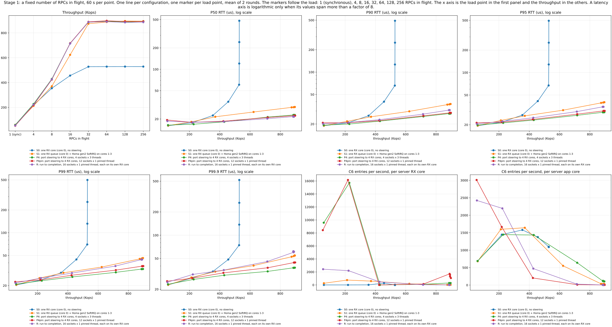
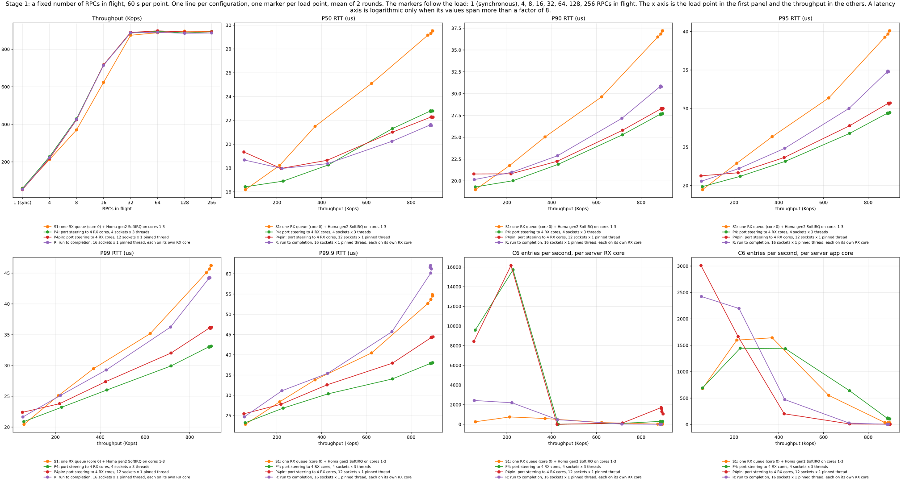
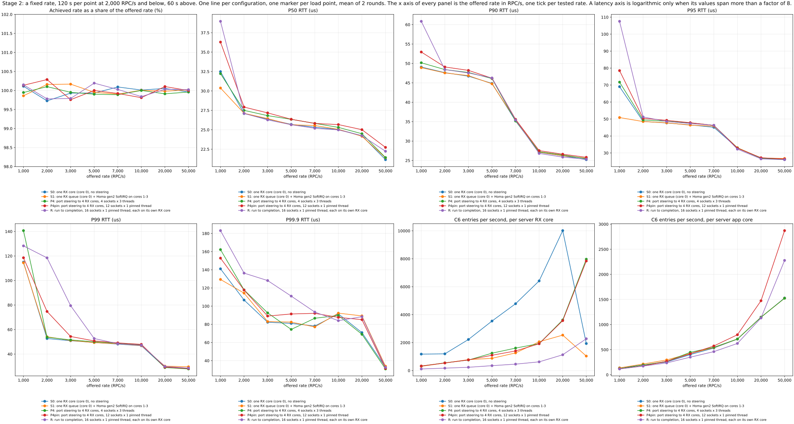

# Low load: one RX core or steering? (BlueField-3, cp_node)

**Contents**

- [In short](#in-short)
- [The configurations](#the-configurations)
- [The runs](#the-runs)
- [Test machines](#test-machines)
- [System configuration](#system-configuration)
- [Results](#results)
  - [Findings](#findings)
  - [Figures](#figures)
    - [Figure 1: stage 1, all configurations](#figure-1-stage-1-all-configurations)
    - [Figure 2: stage 1, without S0](#figure-2-stage-1-without-s0)
    - [Figure 3: stage 2, fixed rate](#figure-3-stage-2-fixed-rate)
  - [Numbers](#numbers)
    - [Stage 1: RPCs in flight](#stage-1-rpcs-in-flight)
    - [Stage 2: fixed rate](#stage-2-fixed-rate)
- [Commands](#commands)
- [Limits](#limits)
- [Files](#files)
- [Reproduce](#reproduce)

Homa runs directly on top of IP (protocol 146). The NIC does not look inside the Homa header, so all packets between two
hosts reach the same RX queue and the same core. [mlx5-flex-l4-steering](https://github.com/breakertt/mlx5-flex-l4-steering)
adds `ethtool` rules that choose the RX queue from a field of the Homa header, for example the destination port.

At low load, one core can handle all the packets. Then keeping them on that core can be better: the cache stays warm,
and the core does not fall asleep between packets. This branch measures that on two BlueField-3 hosts with `cp_node`,
the benchmark tool of Homa. All tools are public.

## In short

- At low load, one RX core is at best a little faster than steering. With 1 RPC in flight it wins by 0.3 µs. From 1,000 to
  50,000 RPC/s the difference is less than 0.7 µs ([Findings](#findings), [Figure 3](#figure-3-stage-2-fixed-rate)).
- With 4 and 8 RPCs in flight, steering by port is the fastest. One RX core stops at about 530 thousand RPCs per second.
  The steering configurations go on to about 890 thousand, where the client is the limit ([Figure 1](#figure-1-stage-1-all-configurations), [Limits](#limits)).
- One core does not stay awake. At 1,000 RPC/s, its core spends 98 % of the time in C6, the deepest sleep state ([Figure 3](#figure-3-stage-2-fixed-rate)).

Words used below: RTT is the time from the request to the response, measured at the client. P50 is the median RTT, and P99
is the 99th percentile. An RX core is a core that handles the packets of one RX queue.

## The configurations

There are five configurations. They differ only in how the server receives the packets. All of them use the same 16 cores
per host.

| name | what it does | server threads | NIC rules |
|---|---|---|---|
| `S0` | all packets go to one RX queue on core 0 (no steering) | 4 ports x 3 threads, on cores 4-15 | none. RPS and RFS are off. |
| `S1` | like `S0`, but the Homa load balancer (gen2) moves the work after the interrupt to cores 1-3 | same as `S0` | none. RPS and RFS are on. |
| `P4` | packets go to 4 RX queues (cores 0-3), chosen by destination port | same as `S0` | 16 rules `l4data k m 0xfffffff0`, `action k % 4` |
| `P4pin` | like `P4`, with one thread for each socket | 12 threads, each on its own core (4-15) | same as `P4` |
| `R` | run to completion: each port goes to the RX queue on the core of the thread that uses it | 16 threads, each on its own core (0-15) | the same 16 rules, `action k` |

RPS and RFS are Linux settings that spread the work after the interrupt over several cores.

Server thread j listens on port 4000+j. The low 4 bits of the port are j, so the rules send port 4000+j to queue j % 4
(`P4`, `P4pin`) or to queue j (`R`). `P4` against `P4pin` shows the effect of the thread layout. `P4pin` against `R` shows
the effect of run to completion. `R` also has 4 more cores for the application, because it has no dedicated RX cores.

The client is the same for all configurations: `cp_node` with 4 sockets, each with 1 sender thread and 2 receiver threads,
on cores 4-15. Its own RX path uses the `P4` rules. The exact command lines are in [Commands](#commands). The system settings are in
[System configuration](#system-configuration).

## The runs

Each configuration ran in two ways, in 2 rounds (round 2 in reverse order).

- **Stage 1:** the client keeps a fixed number of RPCs in flight: 1 (one at a time), 4, 8, 16, 32, 64, 128 or 256. Each
  point runs for 60 s.
- **Stage 2:** the client sends RPCs at a fixed rate, with random (Poisson) gaps: 1,000, 2,000, 3,000, 5,000, 7,000,
  10,000, 20,000 or 50,000 RPC/s. Each point runs for 60 s, and for 120 s up to 2,000 RPC/s.

The client writes out the RTT of every RPC, so the percentiles are exact. Both hosts also record counters at the start and
at the end of each point: the C-state entries and time of each core, the busy time of each core, the NIC drops, and the
packets of each RX queue. The command lines are in [Commands](#commands), and the names of the data files are in
[Files](#files).

## Test machines

| item | value |
|---|---|
| hosts | n08 (server) and n09 (client), two nodes of a lab testbed. BlueField-3 in NIC mode, firmware 32.47.3576, 100 Gb/s, MTU 1500. Two Intel Xeon Silver 4314 CPUs (Ice Lake, 16 cores each) per host. `nosmt maxcpus=16` leaves only cores 0-15 online. These are the cores of NUMA node 0, which is also the node of the NIC. Kernel `6.17.8-mainline-fab`. |
| driver | mlx5-flex-l4-steering `main` 42fd55c, patches 0001-0003. The NICs use the firmware settings `PROG_PARSE_GRAPH=1` and `FLEX_PARSER_PROFILE_ENABLE=4`. |
| Homa | [PlatformLab/HomaModule](https://github.com/PlatformLab/HomaModule) `ae45ada5` with `homa-ae45ada5-ctc3.patch`. The patch changes `CORES_TO_CHECK` from 4 to 3 (`homa_offload.c:13`), so gen2 stays inside the 4 network cores. Only `S1` uses gen2, because gen2 needs RFS. |

The settings of Homa, of the NIC and of the CPU are in [System configuration](#system-configuration).

## System configuration

These settings hold for all configurations and for both nodes. The `# nic` records of the data hold the values.

- **Homa**, set by `config_homa`: `num_priorities` 8, `link_mbps` 100000, `max_nic_est_backlog_usecs` 5,
  `unsched_bytes` 60000, `max_incoming` 1600000, `max_gso_size` 100000. The module defaults give `gro_policy` 114,
  `gro_busy_usecs` 5 and `poll_usecs` 50.
- **NIC**, set by `config_nic`: adaptive RX and TX off, `rx-usecs` 0, `rx-frames` 1, `tx-usecs` 5. RSS sends all packets
  without a rule to queue 0 (`ethtool -X equal 1`).
- **CPU**, set by `config_power` and `setup.sh`: governor `performance`, turbo on, and the C-states POLL, C1, C1E and C6 on.
- **Interrupts and queues**: the IRQ of queue j is on core j. XPS maps TX queue i to CPU i.
- **Monitoring**: `setup.sh` stops the PCP services of the node image.

`run/duck_config.py` calls the functions `config_homa`, `config_nic` and `config_power` of `cloudlab/bin/config` without
change. The table shows the server settings that differ between the [configurations](#the-configurations).

| configuration | NIC rules | RPS mask (`rps_cpus`) | RFS entries |
|---|---|---|---|
| `S0` | none | 0 (off) | 0 (off) |
| `S1` | none | `f` (cores 0-3) | 32768 (`rps_flow_cnt` 2048) |
| `P4`, `P4pin` | 16 rules to queues 0-3 | 0 (off) | 0 (off) |
| `R` | 16 rules to queues 0-15 | 0 (off) | 0 (off) |

The client has the 16 `P4` rules, and RPS and RFS are off. Each run writes one `# nic` record for each node
(`r<round>-<configuration>.<node>.nic` in the [data](#files)). The record lists the module versions, the rules, the RX
queues, the RPS and RFS settings, the coalescing, the governor, the C-states and every `net.homa` setting.

## Results

### Findings

- **At 1 RPC in flight, one core is a little faster.** One RX core (`S0`) has a P50 of 16.1 µs, and steering by port
  (`P4`) has 16.4 µs. From 1,000 to 50,000 RPC/s, the P50 of `S0` and `P4` differs by less than 0.7 µs. The row with 1 RPC in
  flight uses another client than the other rows (see [Limits](#limits)).
- **At 4 and 8 RPCs in flight, steering by port (`P4`) is the fastest.** The P50 is 17 µs against 18 µs for `S0` with 4
  RPCs, and 18 µs against 22 µs with 8 RPCs, where `P4` also carries 21 % more (430 against 355 Kops). From 16 RPCs in
  flight, run to completion (`R`) has the lowest P50 ([Figure 1](#figure-1-stage-1-all-configurations), [tables](#stage-1-rpcs-in-flight)).
- **One core stops at about 530 Kops.** The core is 100 % busy, and the P50 of `S0` grows from 61 µs with 32 RPCs in
  flight to 481 µs with 256. The other four configurations reach about 890 Kops, where the client cores are 100 % busy (see [Limits](#limits)).
- **At that limit, the tails differ.** The P99 is 33 µs for `P4`, 36 µs for `P4pin`, 44 µs for `R` and 46 µs for `S1` ([Figure 2](#figure-2-stage-1-without-s0)).
- **At low rates, all configurations have the same long RTT.** At 5,000 RPC/s the P50 is about 26 µs everywhere. The same
  client has 17 to 18 µs with 4 RPCs in flight. From 2,000 to 20,000 RPC/s, the five configurations are within 1 µs of each
  other ([Figure 3](#figure-3-stage-2-fixed-rate), [tables](#stage-2-fixed-rate)).
- **One core does not stay awake.** At 1,000 RPC/s, the RX core of `S0` spends 98 % of the time in C6. From 2,000 to 20,000
  RPC/s it spends about 50 to 70 %. At 50,000 RPC/s it spends 4 % ([tables](#stage-2-fixed-rate)).
- **Many pinned threads cost latency at 1,000 RPC/s.** The P50 is 39 µs for `R` and 36 µs for `P4pin`, against 32 µs for
  `S0` and `P4`, and 30 µs for `S1` ([Figure 3](#figure-3-stage-2-fixed-rate)).
- **Not measured:** whether leaving C6 causes the extra RTT at low rates. A run with C6 disabled can show this (see [Limits](#limits)).

### Figures

Each figure has 8 panels with one line for each configuration. Each marker is one load point, the mean of 2 rounds. The
caption inside each figure says the same.

#### Figure 1: stage 1, all configurations



The first panel shows the throughput for 1 to 256 RPCs in flight. The next five show the RTT (P50, P90, P95, P99 and P99.9)
against the throughput. The last two show how often the server cores enter C6 each second: the RX cores, then the
application cores. The RTT axes are logarithmic, because `S0` reaches 500 µs and the others stay below 63 µs. The numbers are in the [stage 1 tables](#stage-1-rpcs-in-flight).

#### Figure 2: stage 1, without S0



These are the panels of [Figure 1](#figure-1-stage-1-all-configurations) without `S0`. All axes are linear.

#### Figure 3: stage 2, fixed rate



The panels are the same, but the x axis is the offered rate, with one tick for each tested rate. The first panel shows the
rate that the client reached, as a share of the rate that it had to send. All axes are linear. The numbers are in the [stage 2 tables](#stage-2-fixed-rate).

### Numbers

`python3 analysis/tables.py data/stage1` and `python3 analysis/tables.py data/stage2` print the tables below. All other
numbers are in `data/stage1-sum.txt` and `data/stage2-sum.txt` ([Files](#files) explains the file names).

#### Stage 1: RPCs in flight

**Throughput (Kops)**

| RPCs in flight | S0 | S1 | P4 | P4pin | R |
|---|---|---|---|---|---|
| 1 (synchronous) | 59.6 | 59.5 | 58.6 | 52.5 | 54.3 |
| 4 | 218.9 | 212.6 | 227.7 | 218.4 | 222.4 |
| 8 | 354.6 | 370.6 | 429.6 | 424.2 | 426.8 |
| 16 | 456.4 | 623.5 | 716.5 | 716.7 | 714.2 |
| 32 | 528.0 | 874.3 | 886.6 | 889.6 | 887.5 |
| 64 | 528.7 | 888.0 | 896.1 | 898.1 | 890.3 |
| 128 | 529.1 | 896.1 | 886.9 | 892.1 | 884.9 |
| 256 | 529.0 | 894.9 | 893.2 | 892.5 | 886.6 |

**P50 RTT (us)**

| RPCs in flight | S0 | S1 | P4 | P4pin | R |
|---|---|---|---|---|---|
| 1 (synchronous) | 16.09 | 16.19 | 16.42 | 19.34 | 18.68 |
| 4 | 17.77 | 18.23 | 16.90 | 17.96 | 17.96 |
| 8 | 22.45 | 21.50 | 18.26 | 18.65 | 18.37 |
| 16 | 35.00 | 25.11 | 21.31 | 21.02 | 20.25 |
| 32 | 60.75 | 29.16 | 22.80 | 22.29 | 21.64 |
| 64 | 120.65 | 29.31 | 22.79 | 22.27 | 21.57 |
| 128 | 241.24 | 29.52 | 22.75 | 22.29 | 21.57 |
| 256 | 481.40 | 29.52 | 22.79 | 22.23 | 21.63 |

**P99 RTT (us)**

| RPCs in flight | S0 | S1 | P4 | P4pin | R |
|---|---|---|---|---|---|
| 1 (synchronous) | 20.4 | 20.4 | 20.9 | 22.4 | 21.6 |
| 4 | 23.6 | 25.1 | 23.2 | 23.8 | 25.1 |
| 8 | 29.5 | 29.5 | 26.0 | 27.4 | 29.3 |
| 16 | 44.3 | 35.2 | 29.9 | 32.0 | 36.2 |
| 32 | 69.9 | 45.1 | 33.0 | 36.1 | 44.2 |
| 64 | 131.8 | 45.7 | 33.1 | 36.2 | 44.2 |
| 128 | 255.2 | 46.2 | 33.0 | 36.2 | 44.2 |
| 256 | 498.6 | 46.2 | 33.1 | 36.0 | 44.2 |

80 cells in 40 points. The largest round-to-round Kops spread is 2.4 %. NIC drops (`rx_out_of_buffer`, both hosts): 0. Homa `resent_packets`: 2.

Client cores 4-15 busy at 256 in flight (round 1): S0 82 %, S1 100 %, P4 100 %, P4pin 100 %, R 100 %.

**Steering check** (server, round 1, 256)

| configuration | RX queues used | packets per used queue, min - max (millions) |
|---|---|---|
| S0 | 1 | 32.69 - 32.69 |
| S1 | 1 | 53.00 - 53.00 |
| P4 | 4 | 14.08 - 14.09 |
| P4pin | 4 | 14.06 - 14.07 |
| R | 16 | 3.54 - 3.54 |

#### Stage 2: fixed rate

**P50 RTT (us)**

| offered rate | S0 | S1 | P4 | P4pin | R |
|---|---|---|---|---|---|
| 1,000 RPC/s | 32.49 | 30.38 | 32.23 | 36.30 | 38.97 |
| 2,000 RPC/s | 27.09 | 27.12 | 27.50 | 27.92 | 27.11 |
| 3,000 RPC/s | 26.38 | 26.44 | 26.82 | 27.18 | 26.27 |
| 5,000 RPC/s | 25.70 | 25.65 | 26.34 | 26.36 | 25.65 |
| 7,000 RPC/s | 25.33 | 25.55 | 25.83 | 25.82 | 25.20 |
| 10,000 RPC/s | 25.05 | 25.06 | 25.31 | 25.67 | 24.98 |
| 20,000 RPC/s | 24.23 | 24.16 | 24.49 | 25.02 | 24.24 |
| 50,000 RPC/s | 21.16 | 21.40 | 21.43 | 22.73 | 22.23 |

**P99 RTT (us)**

| offered rate | S0 | S1 | P4 | P4pin | R |
|---|---|---|---|---|---|
| 1,000 RPC/s | 115.0 | 114.5 | 140.7 | 118.5 | 128.3 |
| 2,000 RPC/s | 52.7 | 54.1 | 53.7 | 74.7 | 118.5 |
| 3,000 RPC/s | 50.9 | 51.1 | 51.5 | 54.3 | 79.5 |
| 5,000 RPC/s | 49.4 | 49.4 | 50.0 | 50.7 | 52.7 |
| 7,000 RPC/s | 48.1 | 48.4 | 48.9 | 49.1 | 48.5 |
| 10,000 RPC/s | 46.8 | 47.0 | 47.6 | 47.9 | 47.3 |
| 20,000 RPC/s | 29.2 | 30.1 | 29.0 | 29.4 | 29.9 |
| 50,000 RPC/s | 28.1 | 29.6 | 27.9 | 28.2 | 28.5 |

**Time the server RX cores spend in C6 (% of the window. S0: core 0. R: all 16 cores. Others: cores 0-3)**

| offered rate | S0 | S1 | P4 | P4pin | R |
|---|---|---|---|---|---|
| 1,000 RPC/s | 98 | 99 | 94 | 93 | 95 |
| 2,000 RPC/s | 53 | 98 | 91 | 82 | 95 |
| 3,000 RPC/s | 67 | 97 | 84 | 87 | 94 |
| 5,000 RPC/s | 65 | 90 | 89 | 78 | 93 |
| 7,000 RPC/s | 64 | 81 | 85 | 73 | 92 |
| 10,000 RPC/s | 60 | 76 | 72 | 72 | 90 |
| 20,000 RPC/s | 48 | 71 | 69 | 68 | 85 |
| 50,000 RPC/s | 4 | 57 | 62 | 61 | 71 |

**C6 entries per second per server app core (R: all 16 cores. Others: cores 4-15)**

| offered rate | S0 | S1 | P4 | P4pin | R |
|---|---|---|---|---|---|
| 1,000 RPC/s | 138 | 137 | 123 | 118 | 116 |
| 2,000 RPC/s | 195 | 215 | 194 | 177 | 173 |
| 3,000 RPC/s | 256 | 296 | 267 | 268 | 237 |
| 5,000 RPC/s | 402 | 425 | 448 | 419 | 351 |
| 7,000 RPC/s | 533 | 542 | 548 | 574 | 461 |
| 10,000 RPC/s | 710 | 712 | 713 | 797 | 624 |
| 20,000 RPC/s | 1146 | 1147 | 1146 | 1475 | 1131 |
| 50,000 RPC/s | 1530 | 1525 | 1524 | 2872 | 2278 |

80 cells in 40 points. The largest round-to-round Kops spread is 0.7 %. NIC drops (`rx_out_of_buffer`, both hosts): 0. Homa `resent_packets`: 0.

The achieved rate is 99.4 to 100.5 % of the offered rate.

**Steering check** (server, round 1, 50,000 RPC/s)

| configuration | RX queues used | packets per used queue, min - max (millions) |
|---|---|---|
| S0 | 1 | 3.07 - 3.07 |
| S1 | 1 | 3.07 - 3.07 |
| P4 | 4 | 0.77 - 0.77 |
| P4pin | 4 | 0.77 - 0.77 |
| R | 16 | 0.19 - 0.19 |

## Commands

These are the command lines of the [runs](#the-runs) for the [configurations](#the-configurations). The scripts are in
[Files](#files).

`cp_node` resolves `--servers 1` as the host name `node1`. In `/etc/hosts` of the node image, `node1` is 192.168.12.1
(n08). The client has the id 0. `$U` is `/root/homa-up-ae45ada5/util`.

**Server (n08).** `run.sh` starts the servers once for each configuration and round:

```bash
# S0, S1, P4: 4 ports (4000-4003), 3 threads per port, 12 threads on cores 4-15
cd $U; taskset -c 4-15 ./cp_node server --protocol homa --ports 4 --port-threads 3

# P4pin: 12 processes (j = 0..11), 1 port and 1 thread each, thread j on core 4+j
cd $U; ./cp_node server --protocol homa --ports 1 --first-port $((4000+j)) --port-threads 1 --pin $((4+j))

# R: 16 processes (j = 0..15), 1 port and 1 thread each, thread j on core j
cd $U; ./cp_node server --protocol homa --ports 1 --first-port $((4000+j)) --port-threads 1 --pin $j
```

**Client (n09).** `cell.sh` starts `cp_node` without arguments (interactive mode) under `taskset -c 4-15`. It writes
these lines to the standard input of `cp_node`. It also takes the counter snapshots before and after the window.

```bash
{ echo "client --protocol homa --servers 1 --id 0 --server-ports $NP $A --workload 100 --gbps $G"
  sleep 4; echo "dump_times /dev/null"
  for s in $(seq -w 1 $W); do sleep 1; echo "dump_times /dev/shm/lowload/$cell.$s.rtts"; done
  echo exit; } | taskset -c 4-15 $U/cp_node
```

`$NP` is the number of server ports: 4 for `S0`, `S1` and `P4`, 12 for `P4pin`, and 16 for `R`. `$W` is the window in seconds.
The load point sets `$A` and `$G`:

| load point | `$A` | `$G` |
|---|---|---|
| stage 1, M RPCs in flight (4 to 256) | `--ports 4 --port-receivers 2 --client-max M` | `0` |
| stage 1, 1 RPC in flight (synchronous) | `--ports 1 --port-receivers 0 --client-max 1` | `0` |
| stage 2, rate X in RPC/s | `--ports 4 --port-receivers 2 --client-max 256` | X x 800 / 1e9 |

The client line of one cell for each case, as `cell.sh` writes it:

```bash
# stage 1, P4, 16 RPCs in flight
client --protocol homa --servers 1 --id 0 --server-ports 4 --ports 4 --port-receivers 2 --client-max 16 --workload 100 --gbps 0
# stage 1, R, 1 RPC in flight (synchronous)
client --protocol homa --servers 1 --id 0 --server-ports 16 --ports 1 --port-receivers 0 --client-max 1 --workload 100 --gbps 0
# stage 2, P4pin, 5,000 RPC/s
client --protocol homa --servers 1 --id 0 --server-ports 12 --ports 4 --port-receivers 2 --client-max 256 --workload 100 --gbps 0.0040000
```

The flags, from the help text and the source of `cp_node`:

- Server `--ports N`: N ports to listen on, from `--first-port` (default 4000 for Homa). `--port-threads T`: T threads per
  port. `--pin C`: all threads of the process run only on core C.
- Client `--ports N`: N ports to send from. Each port is one socket and one sender thread.
- Client `--port-receivers R`: R receiver threads per port. With 0, the sender waits for each response (synchronous).
- Client `--client-max M`: the limit of RPCs in flight for the whole client. `cp_node` splits it over the ports, with at
  least 1 per port. Thus the lowest value with 4 ports is 4 RPCs in flight. The synchronous row uses 1 port for this reason.
- Client `--gbps G`: the offered load of the data. With 0, the client sends as long as it is under `--client-max`. With
  more than 0, the arrivals are Poisson, and `G` = rate x 800 / 1e9 for 100 B RPCs.
- Client `--server-ports N`: the client sends to the ports 4000 to 4000+N-1 of the server.
- Client `--servers 1 --id 0`: the server is `node1`. This client is node 0, and `cp_node` never sends to its own id.
- `--workload 100`: 100 B requests and 100 B responses.

## Limits

- The client limits the throughput to about 890 Kops. At that load, compare the latency and not the throughput.
- The row "1 (synchronous)" of stage 1 uses another client (1 socket, and it waits for each response). Compare stage 2 with
  the row of 4 RPCs in flight, which uses the same client ([stage 1 tables](#stage-1-rpcs-in-flight)).
- The client cores also sleep. This adds to every RTT in the same way. The tests do not separate it from the server.
- No run turns C6 off. The C6 counters sit next to the latency and do not prove a cause.
- The tests stop at 1,000 RPC/s.
- `cp_node --unloaded` fails at `ae45ada5` with "measure_rtt got error in recvmsg: Invalid argument". The cause is open. The
  synchronous row replaces it.
- The machine that drives the runs rebooted in the middle of stage 1, after 51 of 80 cells. The other 29 cells ran afterwards,
  each after a new setup. They agree with round 1.

## Files

| path | content |
|---|---|
| `homa-ae45ada5-ctc3.patch` | the one-line change of Homa (`patch -p0` on `homa_offload.c`) |
| `run/` | the scripts that run the experiment: `setup.sh` (one node), `snap.sh` (counters), `cell.sh` (one load point), `run.sh` (the whole run) and `duck_config.py` |
| `analysis/` | `sum.py` (one row for each point), `tables.py` (the tables of this file) and `plot.py` (the figures) |
| `data/` | the raw data of stage 1 and stage 2 (80 cells each), and the sum files `stage1-sum.txt` and `stage2-sum.txt` |
| `figures/` | the three figures |

The name of a cell is `r<round>-<configuration>-cm<load>`. The load is the number of RPCs in flight (`u` for the synchronous row)
or `g<rate>`. The files of a cell are `hist` (the RTT histogram), `window` (start and end time), `client.before`,
`client.after`, `server.before`, `server.after` and `client.log`. The steps to run all of this are in
[Reproduce](#reproduce).

## Reproduce

The versions are in [Test machines](#test-machines) and the settings are in [System configuration](#system-configuration).

1. On the server node (the client node shares `/root`): build the driver of mlx5-flex-l4-steering (`build.sh`
   with patches 0001-0003) in `/root/flex-l4-617/`.
2. Clone HomaModule at `ae45ada5` to `/root/homa-up-ae45ada5` and run `make cp_node` in its `util/`.
3. Copy that tree to `/root/homa-ae45ada5-ctc3`, apply `homa-ae45ada5-ctc3.patch` with `patch -p0`, and build
   `homa.ko` there. Use `cp_node` of the unpatched tree.
4. Copy the files of `run/` to `/root/lowload/`.
5. From a host that reaches both nodes as `ssh n08` and `ssh n09` (root), run
   `./run.sh stage1 2 "S0 S1 P4 P4pin R" "u 4 8 16 32 64 128 256" 60`, and
   `./run.sh stage2 2 "S0 S1 P4 P4pin R" "g1000 g2000 g3000 g5000 g7000 g10000 g20000 g50000" 60`.
   Each run takes about 1 h 50 min. The scripts contain the host names, the addresses and the interface name.
6. Copy `/root/lowload/out/stage1` and `/root/lowload/out/stage2` to `data/`.
7. In the root of this branch, run `python3 analysis/sum.py data/stage1` and `python3 analysis/tables.py data/stage1`. Then do the same for `data/stage2`.
8. Run `uv run analysis/plot.py data/stage1` and `uv run analysis/plot.py data/stage2`.
